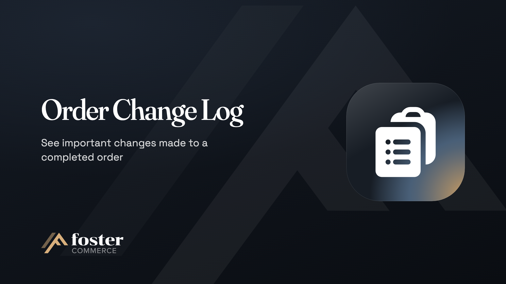

# Order Change Log

See important changes made to a completed order.

Order Change Log records changes made to completed Craft Commerce orders and the user who made each change.

## Overview

- See how a completed order changed after checkout, on the order page's Change Log tab.
- Find who made each change and when, including the user whose action queued a job, and the user who used **Sign in as** to act as someone else.
- Track each line item added, removed, or changed in quantity, total, options, notes, or status, with its SKU.
- Follow changes to the shipping method, coupon code, customer email, shipping and billing addresses, and the order's custom fields.
- Compare the order total before and after each change.

## How it works

After you install the plugin, it compares a completed order before and after each save of the order or one of its addresses, and records each difference with the user who made it. The plugin records a queue job's changes against the user who queued the job. It does not record carts, the save that completes an order, order status changes, payments, address custom fields, or Matrix fields.

## Requirements

- Craft CMS `^5.6.0`
- Craft Commerce `^5.0.0`
- PHP `^8.2`

## Install

```sh
composer require fostercommerce/commerce-order-change-log
./craft plugin/install order-change-log
```

## Documentation

- [Getting started](https://www.fostercommerce.com/craft-cms-plugins/order-change-log/docs/getting-started), from install to the first recorded change
- [The change log](https://www.fostercommerce.com/craft-cms-plugins/order-change-log/docs/user-guide/change-log), what the tab records and what it leaves out
- [Configuration](https://www.fostercommerce.com/craft-cms-plugins/order-change-log/docs/reference/configuration), how long recorded changes are kept
- [Schema](https://www.fostercommerce.com/craft-cms-plugins/order-change-log/docs/reference/schema), the plugin's database tables

## License

Proprietary

---

<a href="https://www.fostercommerce.com" target="_blank"></a>
