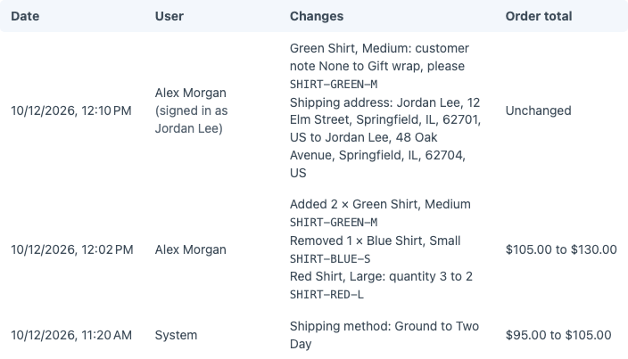

# Getting started

Order Change Log records changes made to completed Craft Commerce orders and the user who made each change.

This walks you from `composer require` to the first change recorded on an order. By the end you know what the Change Log tab records.

## 1. Requirements

- Craft CMS `^5.6.0`
- Craft Commerce `^5.0.0`
- PHP `^8.2`

## 2. Install

```sh
composer require fostercommerce/commerce-order-change-log
./craft plugin/install order-change-log
```

The plugin records changes as soon as you install it. To change how long it keeps them, see [configuration](./reference/configuration.md).

## 3. Change a completed order

1. Go to **Commerce -> Orders** and open a completed order.
2. Click **Edit**, then click **Edit** on a line item and change its quantity. Click **Update order**.
3. Open the order's **Change Log** tab.

The tab lists the change: the line item, its quantity before and after, the order total before and after, your name, and the time.



## Where to go next

- [The change log](./user-guide/change-log.md), what the tab records and what it leaves out
- [Schema](./reference/schema.md), the plugin's database tables
